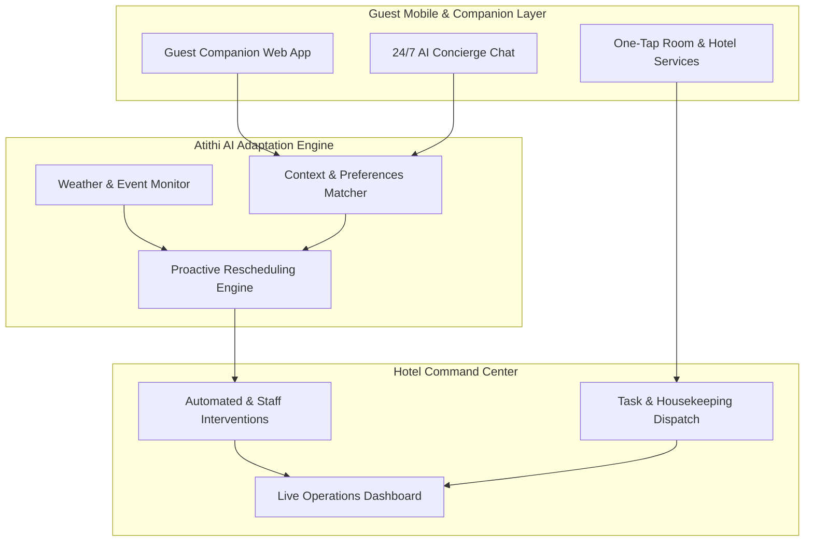

# Atithi AI (अतिथि AI) 🏨✨

[](https://opensource.org/licenses/MIT)
[](https://react.dev/)
[](https://vitejs.dev/)
[](https://tailwindcss.com/)
[](https://github.com/viratpaudel/atithiai/actions/workflows/ci.yml)

> Autonomous AI staff, intelligent concierge, and real-time hyper-personalization for modern luxury hospitality.

Atithi AI is an all-in-one hospitality management and autonomous guest companion platform. Designed for boutique properties and luxury hotels (such as *The Aranya House*), Atithi AI bridges the gap between seamless guest experience and intelligent hotel operations.

It helps hotels deliver hyper-personalized stays using generative AI to craft dynamic itineraries, culinary menus, and activity suggestions that adapt in real time to weather, guest preferences, and property conditions—boosting guest satisfaction and operational efficiency.

---

## 🏛️ System Architecture



---

## 🌟 Key Features & Interface Modules

- **The Atithi Concierge AI**: A conversational companion providing immediate 24/7 assistance with room service, local exploration, spa bookings, and dynamic preferences like dietary tracking.
- **Intelligent Guest Companion (Mobile Web App)**:
  - **Smart Home & Stay Overview**: Real-time visibility into room status (Suite 402 Luxury Suite), checkout countdowns, weather synchronization, and one-tap access to services like housekeeping, valet, and room requests.
  - **Proactive Itinerary Planning**: AI-driven morning briefings and dynamic scheduling tailored to current weather conditions and guest preferences.
  - **Curated Local Experiences ("The Local Edit")**: Context-aware recommendations for local activities—such as Forest Bathing at Maldevta or culinary tasting menus—with instant reservation workflows.
- **Hotel Command Center (Admin Dashboard)**:
  - **Live Guest Activity & Interventions**: Real-time tracking of active guest states, automated request resolutions, and global satisfaction scores.
  - **Demo & Environmental Controls**: Interactive simulation tools allowing operators to test contextual triggers like live weather changes (e.g., triggering rain protocols).

---

## 🏗️ Tech Stack

- **Frontend / UI**: React 18, Vite 5, Tailwind CSS, Framer Motion, Lucide Icons
- **Concierge Engine**: Contextual preference scoring, dynamic weather conflict resolver
- **CI / Quality**: GitHub Actions continuous integration and build verification

---

## 🚀 Getting Started

### Prerequisites

- [Node.js](https://nodejs.org/) (v18+ recommended)
- [Git](https://git-scm.com/)

### Installation & Setup

1. **Clone the repository:**
   ```bash
   git clone git@github.com:viratpaudel/atithiai.git
   cd atithiai
   ```

2. **Configure environment variables:**
   Copy the example environment file and configure your API keys:
   ```bash
   cp .env.example .env
   ```

3. **Install dependencies:**
   ```bash
   npm install
   ```

4. **Start the local development server:**
   ```bash
   npm run dev
   ```

5. **Build for production:**
   ```bash
   npm run build
   ```

---

## 🗺️ Roadmap

- [x] Guest mobile web-app UI & concierge chat interface
- [x] Localized experience discovery and reservation flow (Dehradun pilot)
- [x] Hotel Operations & Command Dashboard with live intervention metrics
- [x] Modular data layer & contextual weather adaptation engine
- [x] Automated CI verification pipeline
- [ ] Deep Property Management System (PMS) integrations
- [ ] Multi-lingual voice interface support

---

## 🤝 Contributing

Contributions, issues, and feature requests are welcome! Feel free to check the [issues page](https://github.com/viratpaudel/atithiai/issues).

1. Fork the Project
2. Create your Feature Branch (`git checkout -b feature/AmazingFeature`)
3. Commit your Changes (`git commit -m 'Add some AmazingFeature'`)
4. Push to the Branch (`git push origin feature/AmazingFeature`)
5. Open a Pull Request

---

## 📄 License

Distributed under the [MIT License](LICENSE). See `LICENSE` for more information.

---

<p align="center">Built with ❤️ for the future of luxury hospitality.</p>
