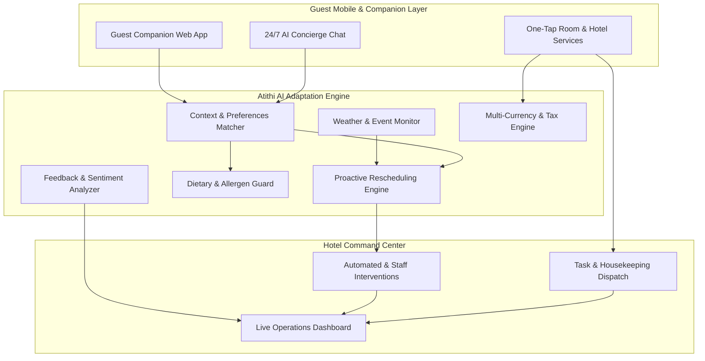

# Atithi AI (अतिथि AI) 🏨✨

[](https://opensource.org/licenses/MIT)
[](https://react.dev/)
[](https://vitejs.dev/)
[](https://tailwindcss.com/)
[](https://github.com/viratpaudel/atithiai/actions/workflows/ci.yml)

> Autonomous AI staff, intelligent concierge, and real-time hyper-personalization for modern luxury hospitality.

Atithi AI is an all-in-one hospitality management and autonomous guest companion platform. Designed for boutique properties and luxury hotels (such as *The Aranya House*), Atithi AI bridges the gap between seamless guest experience and intelligent hotel operations.

It helps hotels deliver hyper-personalized stays using generative AI to craft dynamic itineraries, culinary menus, and activity suggestions that adapt in real time to weather, guest preferences, and property conditions—boosting guest satisfaction and operational efficiency.

---

## 🏛️ System Architecture



---

## 🧠 Intelligence Utilities & Engines

| Utility | Description | File Path |
|:---|:---|:---|
| **Concierge Engine** | Dynamic weather adaptation & personalized activity recommendation | `src/utils/conciergeEngine.js` |
| **Feedback Analyzer** | Guest review sentiment index & hospitality keyword categorization | `src/utils/feedbackAnalyzer.js` |
| **Schedule Validator** | Itinerary duration parser and automated overlap conflict detector | `src/utils/scheduleValidator.js` |
| **Pricing Engine** | Luxury GST tax calculation, service fees, and multi-currency exchange | `src/utils/pricingEngine.js` |
| **Dietary Guard** | Allergen cross-checking and vegetarian/vegan/Jain dietary compliance | `src/utils/dietarySafety.js` |

---

## 🚀 Getting Started

1. **Clone the repository:**
   ```bash
   git clone https://github.com/viratpaudel/atithiai.git
   cd atithiai
   ```

2. **Install dependencies:**
   ```bash
   npm install
   ```

3. **Configure environment variables:**
   ```bash
   cp .env.example .env
   ```

4. **Start local development server:**
   ```bash
   npm run dev
   ```

5. **Run test suites:**
   ```bash
   npm test
   # or natively with Node.js
   node --test tests/*.test.js
   ```

6. **Build for production:**
   ```bash
   npm run build
   ```

---

## 🗺️ Roadmap

- [x] Guest mobile web-app UI & concierge chat interface
- [x] Localized experience discovery and reservation flow (Dehradun pilot)
- [x] Hotel Operations & Command Dashboard with live intervention metrics
- [x] Modular data layer & contextual weather adaptation engine
- [x] Multi-currency conversion & hospitality GST pricing calculator
- [x] Dietary preference and allergen verification engine
- [x] Guest feedback sentiment scoring and service tag categorization
- [x] Comprehensive test suite with native Node.js test runner
- [x] Automated CI verification pipeline
- [ ] Deep Property Management System (PMS) integrations
- [ ] Multi-lingual voice interface support

---

## 🤝 Contributing

Contributions, issues, and feature requests are welcome! Feel free to check the [issues page](https://github.com/viratpaudel/atithiai/issues).

---

## 📄 License

Distributed under the [MIT License](LICENSE). See `LICENSE` for more information.

---

<p align="center">Built with ❤️ for the future of luxury hospitality.</p>
